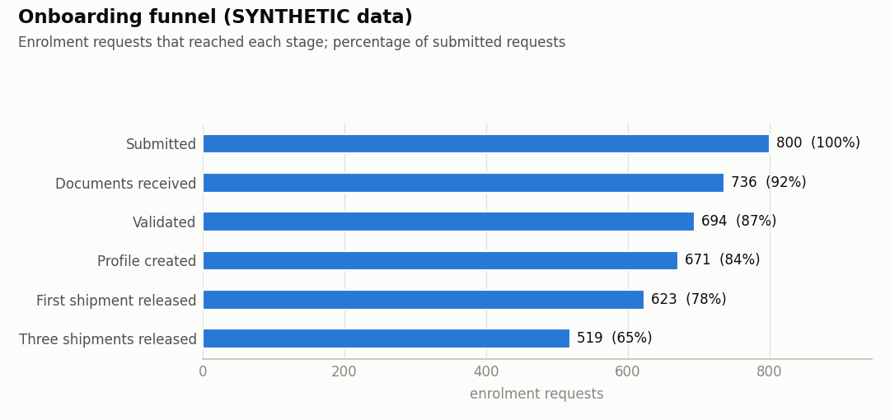
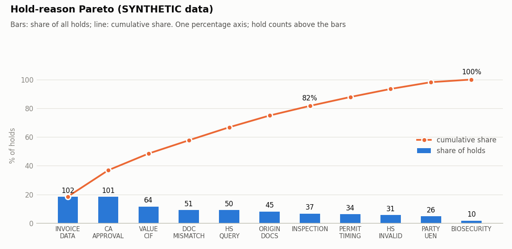
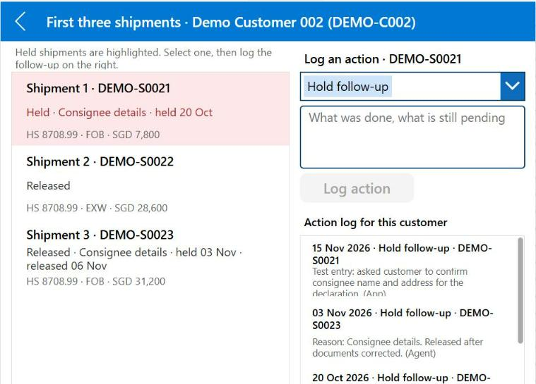

# brokerage-onboard-assist

Customs-brokerage onboarding and shipment-hold analytics: a personal portfolio project. It follows a new customer
from the enrolment request through document checks and a customer profile to the first three shipments, and asks
which holds could have been caught before the declaration was lodged.

**All customer, shipment, hold and action data in this repository are SYNTHETIC** (generated by
`src/boa/synth.py` from documented assumptions). No real company, customer or shipment appears anywhere. The rules
are paraphrased from official public pages and are a study aid, not customs or legal advice.

> README numbers are generated from the results files (`README.template.md` -> `README.md` by
> `scripts/build_all.py`); a test fails if they go stale.

## What is here

| Part | What it is | Status |
|---|---|---|
| 1. [Rulebook](docs/rulebook.md) | 44 rules on customs-hold causes and document readiness: 34 for Singapore imports and exports, 10 for Australia as a second destination; each cites an official page and access date | 28 verified, 14 partially verified, 2 not verified; second pass logged in [docs/rule_check.md](docs/rule_check.md) |
| 2. Synthetic data | 800 customers with enrolment requests, documents, first three shipments, holds with reason codes and free-text notes, release times, action log | generated, deterministic; every parameter in [docs/assumptions.md](docs/assumptions.md) |
| 3. Validator | Document-readiness checks that cite the rules, a readiness score and a draft customer handling note | tested with hand-worked cases |
| 4. Root-cause analytics | Hold-reason Pareto, time to release by reason and lane, a classifier from hold notes to reason codes | computed on the synthetic data only |
| 5. [Power BI project](powerbi) | PBIP: TMDL semantic model and PBIR report (funnel, first-three hold rate, Pareto, clearance lead time, action log) | **not yet opened in Power BI Desktop**; checked offline (below) |
| 6. [Power Apps and Power Automate](power-platform/README.md) | A canvas app and two cloud flows on three Microsoft Lists | **built and tested by hand in a Microsoft 365 account**; exports are not in this repository |

## Headline numbers (synthetic data)

These numbers describe the generator's assumptions, not real customs clearance. They show that the pipeline
computes what it says; they are not findings about any real operation.

| Measure | Value | Results file |
|---|---|---|
| Enrolments submitted / profiles created / three shipments released | 800 / 671 (83.9%) / 519 (64.9%) | `results/kpis.json` |
| First-three shipments, and share with at least one hold | 1,714, 28.3% | `results/kpis.json` |
| Hold rate of shipment 1 / 2 / 3 | 35.5% / 27.1% / 21.0% | `results/analytics/hold_rate_by_shipment_seq.csv` |
| Customers with at least one held shipment among their first three | 59.6% | `results/kpis.json` |
| Holds; most frequent reason; reasons covering 80% of holds | 551; INVOICE_DATA (18.5%); 7 of 11 (81.7%) | `results/analytics/pareto.csv` |
| Median hours from hold to release: all / slowest reason / fastest reason | 19.2 / BIOSECURITY 74.9 / PERMIT_TIMING 5.0 | `results/analytics/release_by_reason.csv` |
| Median clearance hours: all / slowest lane / fastest lane | 16.6 / SG-AU-SEA 28.4 / MY-SG-ROAD 3.5 | `results/analytics/clearance_by_lane.csv` |
| Holds whose reason the readiness check had flagged before lodgement | 82.6% | `results/analytics/readiness_detection_by_reason.csv` |
| Hold rate of shipments with / without a blocking finding | 68.0% of 594 / 7.2% of 1,120 | `results/summary.json` |
| Actions logged; open; overdue; closed on time | 1,267; 120; 477; 68.9% | `results/kpis.json` |
| Hold-note classifier accuracy: seen-template test / held-out-template test | 100.0% / 48.3% | `results/classifier/metrics.json` |
| Mutation check: planted bugs caught | 42 of 42 | `results/mutation_report.json` |




More figures: [hold rate by shipment number](figures/hold_rate_by_shipment_number.png),
[clearance by lane](figures/clearance_by_lane.png), [release hours by reason](figures/release_hours_by_reason.png),
[classifier accuracy](figures/classifier_accuracy.png). The figures are matplotlib renders of the same numbers; they
are not screenshots of the Power BI report.

## 1. Rulebook

`rules/rulebook.json` holds the rules; `docs/rulebook.md` is generated from it. Topics for Singapore: the TradeNet
permit before import or export, UEN and Customs account, HS classification (STCCED 2022), customs value on a CIF
basis with the published flat rates for freight and insurance, GST at 9% on customs value plus duty, the four
dutiable categories, controlled goods and their competent authorities (HSA, SFA, IMDA, NEA and others), prohibited
imports, origin and FTA preference with certificates of origin, invoice data and Incoterms, amendment, cancellation
and voluntary disclosure. For Australia: declaration type by value, FOB-based customs value, GST at 10% of the value
of the taxable importation, ABN, tariff classification, biosecurity (BICON), restricted goods, preference claims and
trade-description labels.

Each rule has a status. *Verified* means the requirement as written was found in the cited page. *Partially
verified* means the requirement was found but the check built on it adds something the page does not say (a
tolerance, the base of a percentage, an HS mapping). *Not verified* marks the two rules no page states: that an
invoice must show its Incoterm (SG-IMP-24, inferred from the valuation pages) and that quantities and weights must
agree across documents within 2% (SG-IMP-28).

Every rule was checked a second time ([docs/rule_check.md](docs/rule_check.md)): 30 were
confirmed as written, 14 partly confirmed and none contradicted; each
discrepancy and the correction made is listed there. A separate session re-read the Singapore, OECD and ABS sources.
The Australian Border Force and DAFF pages refuse automated fetches, so those 10 rules were re-read in a
browser by the session that wrote them; that part of the check is not independent.

The HS-prefix screening tables in `rules/` (which chapters or headings point to which authority) are this project's
heuristic. Singapore Customs decides control by HS code and competent-authority product code; that list is not used
here, so chapter-level screening over-flags (most chemicals are not controlled) and can miss items.

## 2. Synthetic data

`src/boa/synth.py` writes ten tables to `data/synthetic/`, each row labelled `SYNTHETIC`. Customer names are
"Synthetic Customer NNNN" and UENs carry registration year 2099, so none can coincide with a real entity. Holds are
caused by *latent document defects* (missing invoice field, freight not added to an FOB value, outdated HS code,
missing licence, and so on), each with an assumed probability of leading to a hold; the defects are recorded in
`shipment_defects_truth.csv`, which the validator never reads. Later shipments have fewer defects, and a closed
corrective action lowers the chance that the same reason recurs: both effects are assumptions written into
[the configuration](config/synth_assumptions.json), so the falling hold rate from shipment 1 to 3 is an input, not a
discovery.

## 3. Validator

`src/boa/validator.py` checks an enrolment bundle or a shipment bundle and returns findings that each cite a rule:

- HS code format and validity of the first six digits against the HS 2022 list (an HS 2017 code such as 8517.12 is
  rejected); the national digits are only format-checked;
- invoice completeness (number, date, currency, Incoterm, line description, quantity, price, origin) and arithmetic;
- value consistency: the CIF value is rebuilt from the invoice, its Incoterm and the charges on file (using the flat
  rates only where the rules allow) and compared with the declared value; exports to Australia use the FOB value;
- permit timing, importer UEN and Customs account, licence on file and quoted for lines screened to a competent
  authority, proof of origin when preference is claimed, quantities and weights across documents.

Readiness score = 100 minus 25 per blocking finding and 8 per warning (weights are this project's choice). On the
synthetic first-three shipments, 908 are Ready, 212 Needs attention and 594
Not ready. The check had flagged the same reason for 82.6% of the holds. It cannot flag classification
queries on a valid code or random inspections, and it flagged none of those by construction; it also misses value
errors smaller than its 0.5% tolerance and cannot check a value when the invoice has no Incoterm. Because the
generator's defects were designed alongside the validator's checks, this detection rate is an upper bound on what
such a check could do with real documents.

A draft handling note is produced for every profiled customer
(examples: [docs/examples](docs/examples)); it lists products, screened controls, standing instructions with rule
references and open items.

## 4. Root-cause analytics and the hold-note classifier

Pareto, time to release and hold rates are in `results/analytics/`. Percentiles use linear interpolation, the same
definition as DAX `MEDIAN` and `PERCENTILE.INC`.

The classifier maps a free-text hold note to one of 11 reason codes with TF-IDF features (word and character
n-grams) and logistic regression. **The notes are synthetic**: each is written from one of eight templates per
reason, with abbreviations, typos, references and distracting sentences added. That makes the usual random split
too easy, so two test sets are reported: notes from templates the model also saw in training, and notes from two
templates per reason that were written with different vocabulary and kept out of training entirely.

| Method (304 training notes) | Seen-template test (n = 100) | Held-out-template test (n = 147) |
|---|---|---|
| TF-IDF + logistic regression | 100.0% | 48.3% (95% bootstrap interval 40.1% to 55.8%), macro-F1 0.34 |
| Keyword rules written by hand | 88.0% | 11.6% |
| Majority class | 19.0% | 17.0% |
| Local LLM, qwen3.5:4b through Ollama 0.40.2, zero-shot | 96.0% (92.0% to 99.0%) | 96.6% (93.9% to 99.3%) |

The seen-template score mostly measures template memorisation. On unseen phrasings accuracy drops to
48.3%: the model learned the wording of the templates more than the meaning of the reasons.
Leave-one-template-out over all eight templates gives 84.8% pooled accuracy (macro-F1 0.80),
with the worst fold (template 7) at 42.9%. None of this says how the model would do
on notes written by people; that needs real notes.

On the held-out-template notes the zero-shot local LLM (qwen3.5:4b, no training notes, answer constrained to the 11 codes) reaches 96.6% accuracy and macro-F1 0.97, higher than the TF-IDF model's, and the two bootstrap intervals do not overlap. It returned 0 invalid answers and took a median of 6.0 s per note on a laptop GPU while other jobs were running (the linear model's prediction time was not measured). This is one run with one prompt and one small model, on clean synthetic notes whose templates and reason descriptions were written by the same author: it shows that here the LLM depends less on the wording of the templates, not how either method would do on real notes.

## 5. Power BI project

`powerbi/BrokerageOnboard.pbip` opens a semantic model in TMDL (nine tables in a star schema, 26 measures) and a
PBIR report with five pages: onboarding funnel, first three shipments, hold reasons (a line-and-column Pareto whose
cumulative measure is computed dynamically, so it re-ranks under slicers), clearance lead time by lane, and the
action log. Its layout follows the author's earlier `sg-transport-powerbi` project, and the TMDL reader and the DAX
evaluator used for testing were taken from that project and extended. Every measure is documented in
[docs/kpi_definitions.md](docs/kpi_definitions.md) with its DAX, its Python twin and its value on the synthetic data.

**The report has not been opened or rendered in Power BI Desktop.** What was checked without it:

| Check | Result |
|---|---|
| JSON well-formedness and Microsoft's published JSON schemas (pinned commit of `microsoft/json-schemas`) for all 38 PBIP and PBIR files | valid (`tools/validate_schemas.py`; skipped by the tests when the schemas are not fetched, required in CI) |
| Microsoft's Tabular Object Model library (19.117.0) reads the TMDL folder; `Model.Validate()` | no errors; its summary is committed in `checks/tom_model.json` and compared with the test reader |
| References: every field a visual uses exists in the model and is not hidden; pages, visuals and project files point at each other | tested |
| DAX measure text, run by a small evaluator, against an independent pandas implementation in many filter contexts | equal in every tested context |
| Both implementations against values worked out by hand on a tiny model | equal |

The evaluator is not the Analysis Services engine: it implements only the DAX used here, from the documentation.
Where it and Power BI disagree, Power BI is right. Visual rendering, the funnel and combo-chart field roles, sort
orders and formatting can only be confirmed in Desktop; `results/powerbi_expected_values.csv` lists what the main
visuals should show so that the first render can be compared against it. To load data locally, set the `DataFolder`
parameter to the `powerbi/data/` folder.

## 6. Power Apps and Power Automate

Built and tested by hand in a Microsoft 365 account with the Power Apps for Office 365 licence, standard
connectors only: a canvas app "Brokerage Onboard Assist" (enrolment screen and a first-three-shipments screen with
hold highlighting and an action form) and two cloud flows (an enrolment readiness check and a first-three-shipments
hold alert) on three Microsoft Lists with synthetic rows. One test case was run for each flow and one action was
logged from the app in preview. The app is saved but not published, and **no app or flow exports are in this
repository**: [power-platform/README.md](power-platform/README.md) gives the facts, the build sheets and three
screenshots.



## Data provenance

| Input | Label | Source |
|---|---|---|
| Rule texts (`rules/rulebook.json`) | REAL, paraphrased | Singapore Customs, IRAS, Australian Border Force, DAFF, ABS and an OECD sheet supplied by Singapore; URL per rule in `rules/sources.json`, all accessed 2026-11-15 |
| Flat freight-and-insurance rates (`rules/sg_flat_freight_insurance.csv`) | REAL | Singapore Customs, <https://www.customs.gov.sg/doing-business/valuation-duties-and-fees/establishing-customs-value/flat-rates-for-freight-and-insurance/>, accessed 2026-11-15; the country-code column is an ASSUMPTION |
| HS 2022 six-digit codes (`data/reference/hs2022_subheadings.csv`) | REAL, codes only | <https://github.com/datasets/harmonized-system> at commit `b1be3f2`, retrieved 2026-11-15; declared licence ODC-PDDL-1.0, data from UN Comtrade. The WCO holds copyright in the nomenclature text, so descriptions are not redistributed |
| UEN formats (`src/boa/uen.py`) | REAL | OECD, "Singapore - Information on Tax Identification Numbers", <https://www.oecd.org/tax/automatic-exchange/crs-implementation-and-assistance/tax-identification-numbers/Singapore-TIN.pdf>, accessed 2026-11-15 |
| HS-prefix screening tables (`rules/sg_ca_screening.csv`, `rules/au_biosecurity_screening.csv`) | ASSUMPTION | this project's mapping of HS chapters and headings to the authorities named in the rules |
| Readiness-score weights, value and weight tolerances | ASSUMPTION | `src/boa/validator.py` |
| Generator probabilities, delays and distributions | ASSUMPTION | `config/synth_assumptions.json`, listed in `docs/assumptions.md` |
| Lanes, commodity groups, product names, national HS digits, exchange rates | ILLUSTRATIVE | `config/synth_assumptions.json`; the exchange rates are fixed stand-ins, not MAS rates |
| Customers, enrolments, documents, shipments, holds, hold notes, actions (`data/synthetic/`, `powerbi/data/`) | SYNTHETIC | `src/boa/synth.py`, seed 20261115 |
| Hold-note templates | SYNTHETIC | written for this project (`src/boa/note_templates.py`) |
| Local-LLM answers (`results/classifier/llm_predictions.csv`) | model output on SYNTHETIC notes | `scripts/run_llm_baseline.py`; model and Ollama version are recorded in the file |
| Power Platform seed rows (`power-platform/seed/`) | SYNTHETIC | `make_seed.py`, seed 20261115 |
| Power Apps delegation notes (`power-platform/app.md`) | REAL | Microsoft Learn, <https://learn.microsoft.com/en-us/power-apps/maker/canvas-apps/connections/connection-sharepoint-online>, accessed 2026-11-15 |

## Reproduce

Python 3.11.

```
python -m venv .venv
.venv/Scripts/python -m pip install -r requirements.txt     # Linux/macOS: .venv/bin/python
.venv/Scripts/python scripts/build_all.py                   # rebuilds every result, figure, doc and this README, offline
.venv/Scripts/python -m pytest                              # includes a full rebuild compared with the committed results
.venv/Scripts/python mutation/mutate.py                     # plants bugs one at a time; every one must fail a test
```

Scripts that need the network or other software are separate and are not part of the offline build:
`scripts/fetch_hs_nomenclature.py` (downloads the HS file at a pinned commit and checks its SHA-256),
`tools/fetch_schemas.sh` (Microsoft's JSON schemas), `tools/check_tmdl.ps1` (Microsoft's TOM library; PowerShell 7 on
Windows) and `scripts/run_llm_baseline.py` (a local Ollama server). Their outputs that the build uses are committed.
Seeds are fixed; text files are written with LF line endings on every platform.

## Tests

`pytest` runs offline: hand-worked cases for valuation, HS and UEN checks and every validator rule; the generator's
consistency and its documentation; Pareto and percentile arithmetic; classifier split hygiene and metrics; every
DAX measure against pandas and against hand values; the model, the report and the project files; the Power Platform
seed and documents; a rebuild of the whole pipeline compared with the committed results; and this README against
its template. `mutation/mutate.py` then plants deliberate bugs in the core logic, one at a time, and requires the
tests to fail: 42 of 42 caught ([mutation/mutation_report.md](mutation/mutation_report.md)).

## Limitations

- Everything measured here is measured on synthetic data whose structure was chosen by the author. Hold rates,
  reason mix, release times and the effect of corrective actions are inputs. The project shows a method and a tested
  pipeline, not results about real clearance.
- The rules are a reading of public pages on one date (2026-11-15). Pages change; several checks add assumptions the
  pages do not state; two rules are not verified at all. Nothing here is customs advice.
- HS validity is checked at six digits only, and control screening by chapter or heading is a heuristic.
- Australian rules were not independently re-checked (the sites block automated access), and the Australian
  national tariff digits, duty rates and the ABF valuation fact sheet were not used.
- Duty is not computed: Singapore duty rates and Australian tariff rates are outside the scope, so GST estimates
  assume zero duty.
- Exchange rates are fixed illustrative numbers.
- The classifier was trained and tested on templated synthetic notes; its real-world accuracy is unknown.
- The Power BI report has not been rendered. The DAX was checked by a partial evaluator, not by the engine.
- The Power Platform build exists only in one Microsoft 365 account; without exports it cannot be reproduced from
  this repository, and each flow was tested with a single case.

## Licence

MIT, see [LICENSE](LICENSE). The rule texts paraphrase official pages that remain the property of their publishers.
