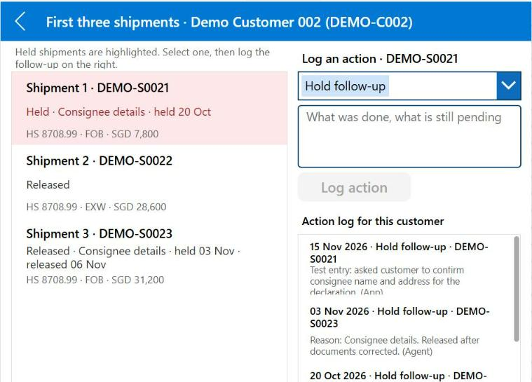
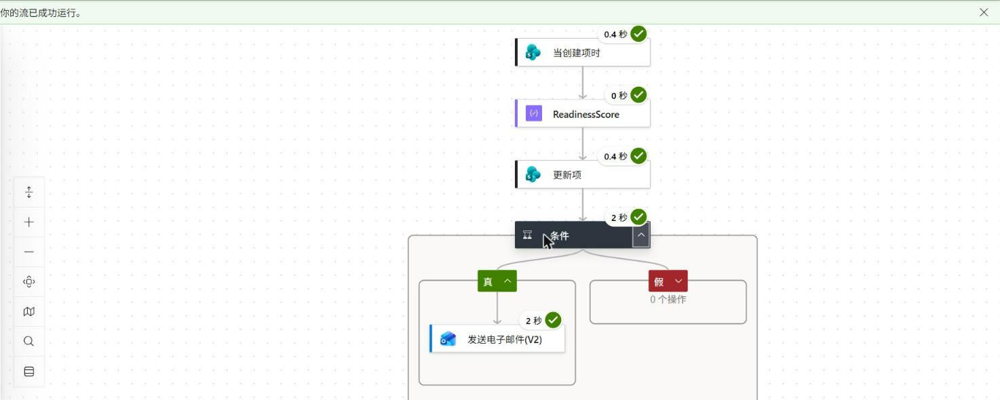
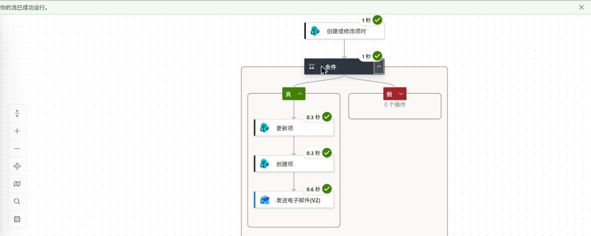

# Power Apps and Power Automate part

**Status: built and tested in the owner's Microsoft 365 account (November 2026).** One canvas app and two cloud flows
run on three Microsoft Lists filled with SYNTHETIC rows. What was built and how it was tested is listed below; what is
*not* in this repository is listed under [Not in the repository](#not-in-the-repository).

The build was done by hand in the browser. This repository's tests do not run the app or the flows; they only check
the seed data and these documents (`tests/test_power_platform.py`).

## Constraints

- Licence: Power Apps for Office 365 (the licence seeded with Microsoft 365), with Power Automate in the same default
  environment. No Dataverse and no premium connectors (no HTTP, SQL Server, AI Builder or custom connectors).
- Data: three **Microsoft Lists** on the owner's OneDrive personal site (`<onedrive-site-url>`), reached through the
  standard **SharePoint** connector. Email through the standard **Office 365 Outlook** connector.
- Emails go only to the owner's own mailbox (`<owner-email>`).
- `<onedrive-site-url>` and `<owner-email>` are placeholders; the real values are never written into this repository.

## What was built

### Data: three Microsoft Lists

BA_Customers, BA_Shipments and BA_ActionLog ([lists.md](lists.md), [lists_schema.json](lists_schema.json)), created
from the seed CSVs in [seed/](seed). The CSV importer produced internal column names such as `field_1` and
multi-select Choice columns, so the lists were rebuilt through the SharePoint REST API: internal column names now
equal the CSV headers and Choice columns are single-select.

### Canvas app "Brokerage Onboard Assist"

SharePoint connector; **saved, not published**.

- Screen 1 was generated from BA_Customers: search, and a profile form that includes the handling notes; the header
  was renamed.
- Screen 2, "First three shipments", was added as pasted YAML. It shows the selected customer's shipments sorted by
  ShipmentSeq with Held rows highlighted, the hold reason and dates; an action form (an ActionType combo box filled
  from `Choices`, and an outcome text box) that Patches a row into BA_ActionLog with LoggedBy "App"; and the
  customer's action log below it.
- A "First 3 shipments" button on screen 1 is shown only for customers whose status is Validated or Active.
- Test: in preview, one action row was written to BA_ActionLog.

### Flow 1 "BA - Enrolment readiness check"

Trigger: SharePoint "When an item is created" on BA_Customers. Steps and expressions:
[flow1_enrolment_readiness.md](flow1_enrolment_readiness.md).

- Compose ReadinessScore (four checks, 25 points each) -> Update item (ReadinessScore; EnrolmentStatus = Validated
  if the score is 100, otherwise Docs pending) -> Condition score < 100 -> Office 365 Outlook "Send an email (V2)"
  to the item's creator, listing the missing documents.
- Test: a customer DEMO-C025 was created with the invoice ready, no packing list, a permit needed but not ready and
  no UEN. The run succeeded in 4 s: score 25, status Docs pending, email sent.

### Flow 2 "BA - First three shipments hold alert"

Trigger: SharePoint "When an item is created or modified" on BA_Shipments, with a trigger condition. Steps and
expressions: [flow2_first_three_hold_alert.md](flow2_first_three_hold_alert.md).

- Condition (Held and ShipmentSeq <= 3 and HeldOn empty) -> Update item (HeldOn = now) -> Create item in
  BA_ActionLog (Hold follow-up, LoggedBy "Flow", outcome text with the hold reason) -> "Send an email (V2)" to the
  person who modified the item.
- Test: shipment DEMO-S0041 (sequence 1, In transit) was set to Held with reason "Permit missing". Exactly one run
  (2 s): HeldOn stamped, one log row added, email sent. The trigger condition stops the flow from firing again on
  its own update; the designer's static "possible loop" warning is still shown.

The flow designer screenshots are in Chinese because of the account's display language.

## Not in the repository

- **No package exports.** The app (.msapp) and the flows (.zip) have not been downloaded into this repository, so
  the build cannot be re-imported from here; the build sheets describe it.
- The app is saved but not published, and it has been tried only in preview.
- The live lists now differ from the seed by the test rows: one extra customer (DEMO-C025), one shipment changed to
  Held (DEMO-S0041) and two extra action-log rows. The seed CSVs in this folder stay as generated.
- Each flow was tested with one case (above). Error paths (for example a failed SharePoint call) were not tested.

## Files

| File | What it is |
|---|---|
| [lists.md](lists.md), [lists_schema.json](lists_schema.json) | The three lists: columns, SharePoint types, internal names, choice values |
| [seed/](seed) | SYNTHETIC seed rows (24 customers, 42 shipments, 26 actions) and the script that made them (`make_seed.py`, fixed seed 20261115) |
| [app.md](app.md) | The app as built, plus Power Fx reference formulas for a SharePoint data source with delegation notes |
| [flow1_enrolment_readiness.md](flow1_enrolment_readiness.md) | Flow 1 as built, step by step |
| [flow2_first_three_hold_alert.md](flow2_first_three_hold_alert.md) | Flow 2 as built, step by step |
| [screenshots/](screenshots) | The app's second screen and one successful run of each flow |

## How this part relates to the rest of the repository

The analytics in `src/`, `results/` and `powerbi/` use a larger SYNTHETIC dataset (800 customers) and a readiness
check with 44 cited rules. This part is a small working prototype of the same process: an enrolment queue, a customer
profile with handling notes, monitoring of the first three shipments, and an action log. Its readiness score is
deliberately simple (four document checks, 25 points each) so a standard-connector flow can compute it.

Known differences between the demo seed and the rulebook, kept because the lists are built from this seed:

- The seed marks **Cosmetics** as `PermitNeeded = Yes` (a demo assumption in `make_seed.py`). The rulebook's
  SG-IMP-16 says cosmetic products are currently not subject to HSA licensing before importation, and the analytics
  validator does not flag HS chapter 33.
- Seed UENs are placeholders (`UEN-DEMO-nnn`) that do not match the UEN formats of SG-IMP-03; flow 1 only checks
  that a UEN is present.
